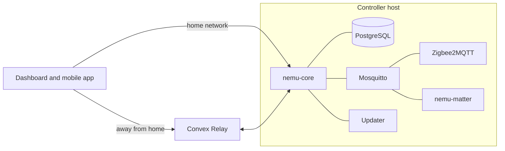

<p align="center">
	<picture>
		<source media="(prefers-color-scheme: dark)" srcset="packages/assets/src/logos/logo-dark.png">
		
	</picture>
</p>

# Nemu

Nemu is a smart home platform that runs on hardware you own. A Controller in your home connects to Zigbee and Matter devices and stores their state and history. You control the devices from a web dashboard or a mobile app, on your home network or away from it.

Nemu is in private alpha. Join the waitlist at [nemu.sh](https://nemu.sh).

## Install a Controller

You need a host that runs Ubuntu Server 22.04 or 24.04 on amd64 or arm64. A Raspberry Pi 4 or 5 works. Zigbee devices also need a USB Zigbee adapter. Matter pairing needs Bluetooth on the host.

1. Read the install script.

	```bash
	curl -fsSL https://get.nemu.sh
	```

2. Install the newest Stable Release.

	```bash
	curl -fsSL https://get.nemu.sh | sudo sh
	```

3. Open [app.nemu.sh](https://app.nemu.sh) to pair with the Controller.

The [install guide](docs/deployment/install.md) covers the Canary channel, installer options, Matter pairing, and updates.

## How the parts connect



Clients try the Controller on the home network first and fall back to Relay. `nemu-core` serves the Controller API on port 6368 and talks to the device adapters over MQTT. The Updater is a systemd service that installs signed Releases and returns to the previous Release if a health check fails.

Clerk handles sign-in. Convex handles invitations, Controller registration, TLS certificates, and Relay messages.

## What stays in your home

The Controller is the only durable store for your device inventory, state, and history. Convex has no tables for them.

Two gaps remain in the alpha:

- **Relay messages are not end-to-end encrypted.** Convex can read a message until it is deleted. Each message has a five-minute expiry.
- **Convex creates and stores the private key for the Controller's LAN certificate.** The [decision to keep Controller private keys local](docs/adr/0009-keep-controller-private-keys-local.md) is accepted but not implemented.

## Set up a development environment

You need these tools:

- Node.js 22.13 or later in the 22 line, or 24.3 or later in the 24 line
- pnpm, at the version in the `packageManager` field of [`package.json`](package.json)
- Rust through [rustup](https://rustup.rs), which reads the toolchain version from `rust-toolchain.toml`
- `cargo-watch` and the PostgreSQL client library, `libpq`
- Docker with Compose
- Clerk and Convex accounts

The git hooks also need `gitleaks` and Bash 4 or later. Dockerfile changes need `hadolint`. The `db:*` scripts need the Diesel CLI.

1. Clone the `canary` branch and install the packages.

	```bash
	git clone --branch canary https://github.com/Zed-Softworks-Official/nemu.git
	cd nemu
	pnpm install
	cp .env.example .env
	```

2. Set the Clerk keys in `.env`.

3. Create a Convex development deployment.

	```bash
	pnpm --filter @nemu/cloud dev
	```

4. Copy `CONVEX_URL` from `packages/cloud/.env.local` to `NEXT_PUBLIC_CONVEX_URL` in `.env`.

5. If the Convex push reports that `CLERK_JWT_ISSUER_DOMAIN` is missing, set it to your Clerk Frontend API URL.

	```bash
	pnpm --filter @nemu/cloud exec convex env set CLERK_JWT_ISSUER_DOMAIN https://your-app.clerk.accounts.dev
	```

6. Start the part you want to work on.

	| Command | What it starts |
	|---|---|
	| `pnpm dev:dashboard` | Dashboard on port 3001 |
	| `pnpm dev:web` | Marketing site on port 3000, dashboard on port 3001, and Expo on port 8090 |
	| `pnpm dev:mobile` | Expo on port 8090 |
	| `pnpm convex:dev` | Convex functions |
	| `pnpm dev` | All of the above, `nemu-core`, and the Docker services |

`pnpm dev` starts PostgreSQL, Mosquitto, and Zigbee2MQTT. Zigbee2MQTT expects an adapter at `/dev/ttyACM0`, so `pnpm dev` needs a Linux host with that device. Without an adapter, start the other two services and run `nemu-core` yourself:

```bash
docker compose -f docker-compose.dev.yml up -d postgres mosquitto
cd platform/core && cargo run
```

`nemu-core` applies database migrations when it starts. If no client is paired, it prints a pairing code in its log.

Registration and Relay need more settings. See `NEMU_CONVEX_SITE_URL` and `CONTROLLER_REGISTRATION_SECRET` in [`.env.example`](.env.example), and the [Controller JWT setup](packages/cloud/README.md).

To run the Matter adapter too, use `pnpm infra:full`. It needs Linux for host networking and Bluetooth.

## Check your changes

| Command | What it checks |
|---|---|
| `pnpm test` | TypeScript tests |
| `pnpm check-types` | TypeScript types |
| `pnpm clippy` | Rust lints |
| `pnpm fmt:rust` | Formats the Rust code |
| `pnpm format` | Formats the TypeScript code |

`pnpm test` does not run the Rust tests. Run `cargo test` in `platform/core` or `platform/updater`. The Matter adapter's MQTT parity suite is `pnpm --filter @nemu/matter-harness harness` (see [`platform/matter-harness`](platform/matter-harness)).

## Find your way around

| Path | Contents |
|---|---|
| [`apps/dashboard`](apps/dashboard) | Next.js dashboard, deployed at `app.nemu.sh` |
| [`apps/mobile`](apps/mobile) | Expo app for iOS and Android |
| [`apps/web`](apps/web) | Next.js marketing site, deployed at `nemu.sh` |
| [`platform/core`](platform/core) | `nemu-core`, the Rust Controller service |
| [`platform/matter-adapter`](platform/matter-adapter) | `nemu-matter`, the Matter adapter, on matter.js in TypeScript |
| [`platform/matter-harness`](platform/matter-harness) | MQTT parity suite for the Matter adapter, with simulated Devices |
| [`platform/updater`](platform/updater) | Updater and Release publisher, in Rust |
| [`packages/cloud`](packages/cloud) | Convex schema and functions |
| [`packages/controller`](packages/controller) | Client connection code for LAN and Relay |
| [`packages/protocol`](packages/protocol) | TypeScript and Zod types for the Controller API |
| [`packages/ui`](packages/ui) | Shared UI components |
| [`packages/assets`](packages/assets) | Logos, icons, and art |
| [`infra`](infra) | Docker Compose files and service configuration |
| [`docs`](docs) | Deployment guides and architecture decision records |

[`CONTEXT.md`](CONTEXT.md) defines the project's terms. [`docs/adr`](docs/adr) records architecture decisions, including some that are not implemented yet.

## Open a pull request

Cut your branch from `canary` and open the pull request against `canary`. The `master` branch is Stable and takes changes from `canary`. Write commit messages as [Conventional Commits](https://www.conventionalcommits.org). A git hook checks them.

Maintainers publish Releases with the steps in the [publishing guide](docs/deployment/install.md#publishing-a-release-maintainers).

## License

The code is licensed under the [Apache License 2.0](LICENSE).

The art in [`packages/assets/`](packages/assets/) is proprietary and licensed separately under [LICENSE-ART](LICENSE-ART). Only Zed Softworks LLC may use it commercially.
